# Biosys, remaster build: player's manual

Biosys is a 1998 Windows survival game set inside a sealed biosphere. You play one person who wakes up in it with
little memory and has to stay alive while the place around you keeps changing: plants grow and die, the tide goes in
and out, machines need power, and the weather outside moves. This manual is for the **remaster build**, an
unofficial native port (C++17, SDL3, macOS) that reads the original game's data files. It adds two optional settings
that change how forgiving and how realistic the world is, and a set of optional improvements to picture, sound and
comfort (smooth and wide panoramas, clean pictures, sharp text, cleaner sound, autosave, a preferences file). All of
them are off unless you ask for them: started plainly, it is the 1998 game.

This manual describes what the port does today and says where something is missing (section 10). Anything that would
spoil discovery is kept in Appendix B, under warning lines.

---

## 1. Getting started

### 1.1 What you need

The port is unofficial and contains **no game data**. You need your own copy of the original game: the two CD images
of the English Windows release, "Setup CD" and "Game CD". The port never runs or loads the original `BioSys.exe` or
`BiosGame.dll`; it only reads data.

**The app (macOS).** Open **Biosys Remaster**. The first time, it shows a start screen instead of the game:

1. **Open the download page** takes you to the game's page on My Abandonware
   (<https://www.myabandonware.com/game/biosys-f2f#downloads>). Download both files there: "Game CD" (502 MB) and
   "Setup CD" (317 MB).
2. Drop both downloaded files anywhere on the app's window, together or one after the other, or pick them with
   **Choose files…**. You do not need to unpack them. If your browser unpacked them already, drop the two folders.

The app checks each file, shows its progress on two cards ("Setup CD", "Game CD"), copies what the game needs (about
1 GB) into its own folder and then starts the game. Your downloads are only read. The app also takes the disc images
themselves (`.img`, `.iso`), a folder with an unpacked disc, or the folder of an installed copy of the game. If a file
is not one of the two discs, or a download is damaged, the screen says so in a sentence and you can try again. From
then on the app starts straight into the game.

The imported data is kept in `gamedata` inside the app's folder (`~/Library/Application Support/biosys/biosys/`, next
to your saved games). Delete `gamedata` to be asked for the files again.

**For developers.** The environment variable `BIOSYS_DATA` overrides all of this: a colon-separated list of folders,
each of which contains `Biodata` and `Biotime` (upper or lower case does not matter). Folders earlier in the list win,
so put the installed copy first and the CD second:

```
export BIOSYS_DATA="/path/to/installed/DATA1:/path/to/cd/files"
```

`--data-home DIR` moves the folder the app imports into. `NewGame.sav` is looked up in the save folder first, then in
the data folders.

### 1.2 Starting the game

The app starts the game by itself. The command lines in this manual are for the program started from a terminal,
where the game logic has to be asked for (`--play` is the same as `--game`):

```
build/biosys --game
```

Inside the app the program is `Biosys Remaster.app/Contents/MacOS/Biosys`; every option below works there too, and
most of them are in the settings menu (section 1.8), so you rarely need a terminal.

Without `--game` the program is only a page viewer (no rules, no player). The window opens at 1280 x 960 (at 640 x 480 on
a screen too small for that) and can be resized; the 640 x 480 picture is scaled by whole numbers and centred, with black
bands round it.

**Which screen:** with more than one screen, `--display dell` (a part of the screen's name) or `--display 2` opens the window
on that screen, and full screen is then on that screen too; `build/biosys --display list` prints the screens with their numbers.
While you play, **Option+N** moves the window to the next screen (a full-screen window stays full screen there). The screen the
window was on when you quit is remembered in the preferences file.

**Getting the mouse out:** while you look around, the game keeps the pointer inside its window. **Option+M** lets go of it: the
game pauses, the normal arrow appears and you can drag the window or use another program. A click on the picture (or Option+M
again) goes on. The same happens by itself when you come back to the window with the pointer beside the picture, for example
by a click on its title bar.

**Full screen:** start with `--fullscreen`, or press **Option+Return** (Alt+Return) at any time to switch to the desktop
full screen and back, on the screen the window is on. The picture keeps its whole-number scale with black bands, so it stays sharp. The key does nothing
while the game is asking you to type something (a password, a page name).

### 1.3 The start-up flow

1. A black screen with "loading...".
2. The intro movies. Any key skips the current part; **Esc** jumps to the main menu.
3. The main menu ("save game" is greyed out until a game runs). Choose **new game**.
4. The new game starts on a flooded rainforest path at 08:00 on day 1 (27 Dec 2007 on the terminal's clock).

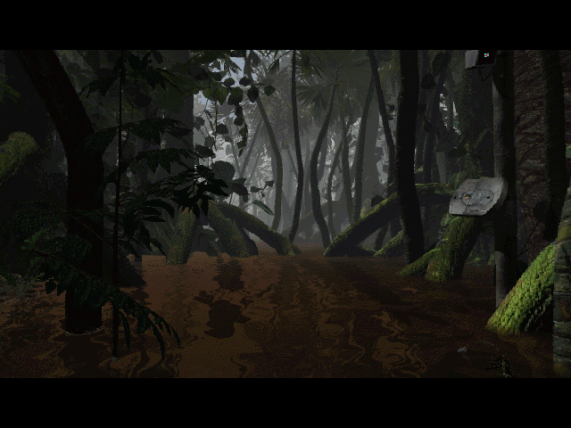

*The start page of a new game. The black bands above and below are the top bar and the inventory bar.*

`--skip-intro` goes straight from the command line to step 4.

### 1.4 Options a player needs

| option | meaning |
|---|---|
| `--game` | run the game (required) |
| `--skip-intro` | start a new game at once; `--intro` forces the intro |
| `--realism faithful\|corrected\|closedloop` | how the simulation is corrected (default `faithful`; section 9) |
| `--difficulty guided\|original\|survivor` | how hard the world presses on you (default `original`; section 9) |
| `--mute` | do not open an audio device |
| `--audio original\|enhanced` | sound path: `original` (default) mixes as the 1998 game's sound code is understood to; `enhanced` is a cleaner conversion of the same sounds (see **Sound** below) |
| `--volume N` | master volume, 0 to 100 (default 100); also on keys while you play |
| `--volume-effects N` | volume of the sounds of the world (one-shot sounds, ambience, loops), 0 to 100 (default 100) |
| `--volume-movies N` | volume of the sound of the movies, 0 to 100 (default 100) |
| `--volume-terminal N` | volume of the BioSys 4 terminal's own sounds (clicks, loops, welcome), 0 to 100 (default 100) |
| `--fullscreen` | start in full screen (**Option+Return** switches it while you play) |
| `--display N\|NAME\|list` | the screen the window opens on: a number (1 = the main screen), a part of its name (`dell`), or `list` to print the screens (section 1.2) |
| `--panorama original\|smooth` | how panoramas are drawn: `original` (default) as the 1998 game does, or `smooth` at the window's own resolution (section 9.4) |
| `--widescreen` | on panoramas use the whole width of a wide window; implies `--panorama smooth` (section 9.8) |
| `--interface original\|overlay` | the screen: `original` (default) has the 1998 bars above and below the picture, `overlay` lets the picture fill the whole window and shows the status words, the messages and your objects over it only when there is something to show; implies `--panorama smooth` and `--widescreen` (section 9.10) |
| `--text original\|sharp` | how the game's own text is drawn: `original` (default) enlarged with the picture, or `sharp` at the window's own resolution (section 9.7) |
| `--picture original\|clean` | how pictures are drawn: `original` (default) as the 1998 game does, or `clean`: the dither taken out of skies, mist and grass and the picture enlarged smoothly; implies `--panorama smooth` and `--text sharp` (section 9.9) |
| `--pass-ms N` | the pace of the game: one game step every N milliseconds, 10 to 100 (default `33`). Lower is faster, higher is slower; it does not depend on your screen's refresh rate (section 9.5) |
| `--panorama-filter linear\|nearest` | with `smooth`: soft (`linear`, default) or hard-edged pixels |
| `--start-muted` | start with the sound muted (the **\\** key toggles it) |
| `--save-dir DIR` | where saved games go (default: the per-user application folder: the `biosys` folder inside Application Support in your user Library) |
| `--autosave yes\|no` | autosave on (default) or off (section 1.6) |
| `--autosave-minutes N` | minutes of play between two timed autosaves, 0 to 1440 (default `10`; `0` = no timed autosave, but waking up and quitting still save) |
| `--load-autosave [1\|2\|3]` | start directly in that autosave (default: the newest); needs `--game` |
| `--save-pages N` | pages of save slots in the save and load menus, 1 to 20 (default `4`; `1` = the original's ten slots only) |
| `--pause-on-focus-loss yes\|no` | pause the game while the window has lost the focus (default `yes`; section 9.6) |
| `--mouse-sensitivity F` | factor 0.25 to 4 on the mouse movement that turns the view (default `1`; section 9.6) |
| `--config FILE` | use this preferences file instead of `biosys.conf` in the save folder (section 1.7) |
| `--no-config` | neither read nor write the preferences file |
| `--write-config` | write the settings in force (file plus command line) into the preferences file and exit |
| `--dev` | switch on the developer keys (Appendix B.4); off by default, and you do not need it to play |
| `--help` | list every option, including developer options |

**Sound.** The game's sounds are 8-bit recordings at 11 or 22 kHz, and a modern sound device runs at 44.1 or 48 kHz. In the
default `original` mode the program stretches them to the device's rate by drawing straight lines between neighbouring samples,
adds the voices up and cuts anything that would be louder than the device allows; that is simple and keeps the sounds exactly as
they were, but the straight lines leave a faint metallic edge on bright sounds and the high notes are dulled. With `--audio
enhanced` the same samples are converted with a proper low-pass interpolation (the mixing is done in floating point at the
device's own rate), a very loud sum is rounded off smoothly instead of being cut, and every start, stop, pause, restart and
volume or pan change is faded over about three thousandths of a second, which removes the clicks the original makes there. A
looping sound joins at its loop point without an extra jump. What it cannot change: the 8-bit hiss and roughness are in the
recordings and stay, and sounds that were never recorded above 11 kHz do not get a treble they never had; no reverb, equaliser or
other effect is added. Volume: the groups (`--volume-effects`, `--volume-movies`, `--volume-terminal`) and the master volume
simply scale the sounds they name (a level of 50 is half the amplitude); at 100 everything is exactly as without the options.
While you play, **-** makes the master volume 10 points quieter, **=** (or **+**) 10 louder, and **\\** (backslash) mutes or
un-mutes; the level shows in the window title for a moment. These keys do nothing while a menu or a text entry is open. I could
not judge the sound by listening; to compare, start the same game twice, for example `build/biosys --game --skip-intro` and
`build/biosys --game --skip-intro --audio enhanced`, and listen to the rain or the movies in both.

**Saved games remember their settings.** The realism level, the difficulty and the fix list of a game are stored *inside* its
save file, in a short block after everything the original game writes (the original's part of the file is unchanged, byte for
byte, and a program that knows only the original's layout simply stops before the block). When you load that save, the game
continues under *those* settings, whatever options you started the program with, and the program prints one line saying so if
they differ. A new game uses what you chose on the New game screen (section 1.8), or the options if the screen is skipped. A save
without a block (a save of the original game) is loaded under the options of the command line and the preferences. Saves
made by earlier versions of the port kept the settings in a file next to the save (`Saved Game 3.settings`); such a save still
loads under that file, and the file is removed when you save over that slot. A block that is damaged is reported on the terminal
and ignored, never a crash. Start values of a difficulty level (section 9) only apply to a *new* game. Copying a save to
another computer takes its settings along, since they are in the file.

### 1.5 Saving and loading

* **Esc** opens the main menu (new game, load, save, controls, credits, quit). The game clock stops while a menu is open.
* **F5** opens the save page directly, **F6** the load page. A page has ten slots (more pages: section 1.6). Each slot shows a
  description such as "Saved Game: Day 1, 08:02, Rainforest, 0% completed", or "-- empty --".
* Click a slot to save or load it. Saving over a used slot asks for confirmation (Y or N).
* Saved games are files named `Saved Game N.sav` in the save folder (their settings are inside). **Esc** goes back one page, and from the main menu
  back to the game. To leave the program choose **quit** and answer Y.

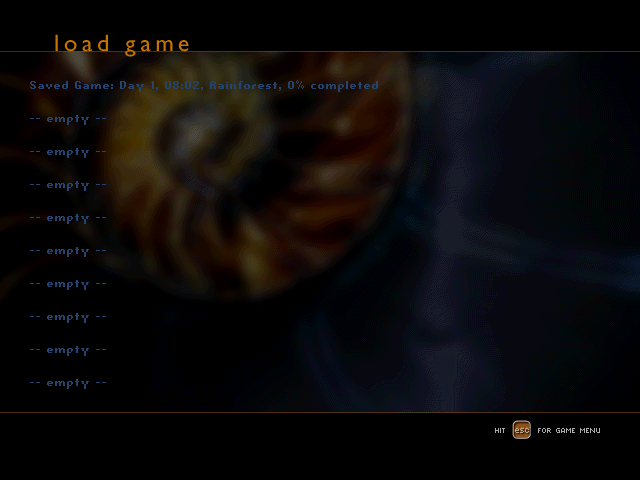

*The load page (F6). Empty slots are listed as "-- empty --".*

### 1.6 Saving: pages of slots and autosave

**Pages of slots.** The save and load pages of the 1998 menu have ten slots drawn on fixed art. The port keeps that as **page 1** (the
files `Saved Game 1.sav` to `Saved Game 10.sav`, exactly where the original put them, so saves of the original game show up in their
old places) and adds more pages with the same art. **Page Down** and **Page Up** (or the mouse wheel) turn the pages of the save
or load list; the current page is written at the top right of the menu as "page 2/4" in the menu's own small type and colour, and in
the window title. Page 2 holds the slots 11 to 20 (`Saved Game 11.sav` to `Saved Game 20.sav`), page 3 the slots 21 to 30, and so on;
the original never reads files with those numbers, so they cannot disturb a game that you also play with the original program. The
menu always opens on page 1. The number of pages is `--save-pages` (default 4; with `1` the menu is the original's).

**Autosave.** The port keeps three rotating automatic saves in the save folder: `autosave1.sav` (the newest), `autosave2.sav` and
`autosave3.sav`, with the settings inside like any other save (so a load continues under the settings it was saved with).
They are written through the normal save, so they are the same kind of file as `Saved Game N.sav` and show the same description when
you list them, but they do not appear in the menu's slots; load one with **F9** or `--load-autosave`. An autosave is made

* every `--autosave-minutes` minutes of play (default 10; the time counts while the game runs and the window is not paused, also
  while a menu is open),
* when you wake up from sleep,
* when you quit the program with a game running (the menu's **quit** and **Y**, or closing the window).

A save that is due waits for the next moment the game would let you save yourself: never while a menu or a text entry is up, while a
movie, a journey, a fade or another animation runs, while you sleep, while a vision or a sequence plays, after your death or after
the end of the game. (When you quit from the menu, the menu is the one place the program saves from, as it does for you.) A failed
autosave (for example an unwritable folder) is reported on the terminal and the game carries on; the older autosaves are left as
they were, and the next attempt comes one interval later. A new autosave first goes to a temporary file and is rotated in only when
it was written whole.

**F9 loads the newest autosave.** The first press shows "press F9 again within 3 s to load autosave 1" in the window title; a second
press within three seconds loads it. F9 does nothing while a menu or a text entry is up, and (like F6) not while you sleep.
`--load-autosave` does the same at start-up: it skips the intro and the new game and starts in the autosave.

### 1.7 The preferences file

Instead of typing options on every start, put them in `biosys.conf` in the save folder (the folder of `--save-dir`, or the default
per-user folder). The first time the window starts without such a file, the program writes one in which every setting is listed
with a short explanation and its default, **commented out**: remove the `#` in front of a line and change the value.

```
# Master volume 0..100 (the - and = keys change it while playing; the level at exit is kept).
volume = 70
```

* One `key = value` per line; a line that starts with `#` is a comment. The keys are the long options without the dashes
  (`pass-ms`, `panorama-filter`, `autosave-minutes`, ...); switches take `yes` or `no`.
* Order: built-in default, then the file, then the command line, so `--volume 40` beats `volume = 70`. Any option also
  takes `--name=value`, which is how a switch in the file is turned off for one run: `--fullscreen=no`.
* A line the program does not understand (a misspelt key, a bad value) is reported once on the terminal and ignored; the rest of
  the file is used.
* What you change in the settings menu (section 1.8) is written at once. What you change with keys while playing is saved when you quit: the **volume**, the **mute** state (key `start-muted`) and **full screen**.
  Only those lines are changed; your comments and other lines stay. Values that you did not change are not written back over the
  file (a `--volume 40` on the command line does not replace `volume = 70` in the file).
* `--write-config` writes the settings in force (file and command line together) into the file and exits; `--no-config` ignores the
  file for one run; `--config FILE` uses another file.
* The test modes (`--script`, `--screenshot`, `--selftest-all-pages`) ignore the preferences file unless `--config FILE` names one.


### 1.8 The settings menu and the New game screen

**New game.** In the original start-up flow (`--game` without `--skip-intro`) choosing **new game** in the main menu first shows
a **New game** screen with two lists. *Realism:* Faithful (the 1998 game, bug for bug), Corrected (repairs the evident bugs and three
model errors) and Closed loop (corrected plus a closed water and humidity cycle). *Difficulty:* Guided, Original and Survivor
(section 9.2). Each choice has a short description. **Faithful + Original is the 1998 game**; the realism levels were measured but
are not play-tested for long, and the balance of Guided and Survivor is unproven (section 9.3). The choices start as the options and the
preferences say (Faithful and Original unless you changed them). Click a choice, or use Up / Down inside a list, Left / Right to
change list, Tab to reach **Start** and **Back**, Return to start, Esc for Back. Start begins the game under the choice, which is
then stored in the saves of that game and written into the preferences as the choice offered next time (only when it differs from
what was offered). Back returns to the menu; nothing has started. If you do not touch the screen and press Start, the game is
exactly the game without the screen. `--skip-intro` and scripted starts skip the screen and use the options.

**Settings menu.** **F10** (or **Cmd+,**) opens it while you play and on the main menu (a small "F10 settings" in the corner of the
main menu says so); **Esc**, **F10** or the **Close** button closes it. It does not open while the game asks you to type something. While it
is open the game is paused (as when the window loses the focus), the mouse is the desktop's, and no key or click reaches the game.
It is drawn over a darkened picture on the same 640 x 480 grid as the game, in the middle (so in `--widescreen` it stays in the
4:3 part), in the game's own typeface at the window's resolution. Five tabs; each row has a label and a value: a choice (click the
arrows or the value, Left / Right, Return) or a slider (click or drag, Left / Right, Shift for larger steps, Home / End, the mouse
wheel). Up / Down choose the row, Tab / Shift+Tab the tab. The bottom shows what the selected row does and when it applies.

| tab | rows | applies |
|---|---|---|
| Game | the realism and difficulty of the running game (read-only: fixed when the game was started; the fix list too if you gave one), and the realism and difficulty offered by the next New game | the second pair: next new game |
| Picture | panorama (original / smooth), panorama filter, widescreen, picture (original / clean), text (original / sharp), interface (bars / over the picture, section 9.10), full screen, screen | now |
| Sound | sound path (original / enhanced), master, effects, movies and terminal volume, muted | now |
| Controls | pace (`pass-ms`), mouse sensitivity, pause when the window loses the focus | now |
| Saving | autosave on / off, minutes between autosaves, pages of save slots | now |

Everything the menu changes takes effect at once, and every change is written into the preferences file (your comments and
other lines stay); with `--no-config` nothing is written and the menu says so. The over-the-picture interface needs smooth panoramas and widescreen (it switches them on). Widescreen needs smooth panoramas and clean pictures
need smooth panoramas and sharp text, so the menu switches those along (and switching smooth panoramas or sharp text off
switches off what needs them). Notes: the audio mode closes and opens the sound device again; sharp text switched on live shows
only text the game draws afterwards; the number of save pages is used the next time a save or load list opens; a change of
**Screen** moves the window like Option+N. Not in the menu: `--game`, `--skip-intro`, `--mute`, `--fixes`, `--dev` and the test aids.
The tabs that are reached by the keys of section 1.5 (volume keys, Option+Return, Option+N) show the live value when the menu opens.

---

## 2. The situation

You come to in the rainforest of a sealed biosphere: a closed world with several climates under glass and rock, built
around machines that keep the air, water and temperature livable. Something went wrong here. The machines still run,
but nobody is looking after them, and you cannot remember much about who you are or what happened.

Your first job is to live: find water and food, get your bearings. After that you must learn how the place works,
because you depend on it for food, medicine and air, and it slowly fails without attention. Your body and the biosphere
are both simulated in real time, and the same place can look different from one visit to the next.

---

## 3. Moving and looking

### 3.1 Pages and panoramas

The game is a set of pictures called pages. Most outdoor places are **panoramas**: 360-degree views that wrap around.
You look around by moving the mouse; the view turns and the mouse pointer stays in the middle of the picture. The
panorama is shown through a cylindrical projection, so straight lines bend slightly near the edges. The arrow keys
also turn the view.

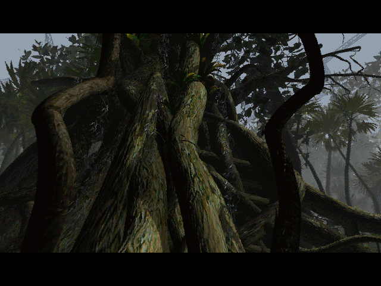

*Looking around a panorama. The pointer rests in the middle of the view.*

* Looking far up or down releases the pointer so you can reach controls at the top or bottom of the picture.
* Hold **Ctrl** to free the pointer without turning the view. Close-ups and machine pages are not panoramas; the pointer
  moves freely there.

### 3.2 Pointer shapes

Whatever is under the middle of the view decides the shape of the pointer. The shapes are:

| shape | where it appears |
|---|---|
| small circle | nothing special here: look around |
| larger ring | an object, a machine or a control you can click |
| tall arrow pointing up | a **long journey** to another place |
| short arrow pointing up | a **short journey** |
| petals gathered inward | a plant or animal you can look at closely |
| flower | fruit, a flower, bark or a tuber you can pick |
| small arrow pointing down | a path that goes **down** (into the tunnels, for example) |
| crossed arrows | a **blocked** path |
| rectangle | the inventory bar |

**F1** toggles help hints: the top bar says what a click will do, for example "left click to follow this path".

### 3.3 Close-ups and returning

Clicking something marked with the plant or ring pointer zooms in to a close-up page. A close-up may hold plants, objects
or machine controls. **Right-click** to return to the place you came from; this works on plant, machine and similar close-ups. The port jumps back
at once; the original's zoom-out animation is not reproduced.

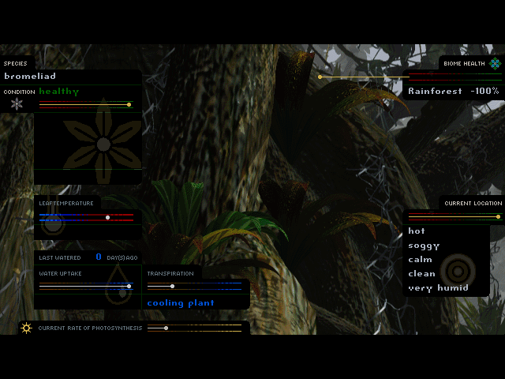

*A close-up. Here the plant status screen (section 7) is displayed over it. The word THIRSTY at the top is a warning from
your body (section 5).*

### 3.4 Travel between places

Click a path (tall or short arrow) to walk to the next place. Travel takes game time and costs energy:

* Longer paths and heavier loads cost more energy. Too tired: "too tired to move"; too much load: "carrying too much to walk".
* The more tired you are, the longer the walk takes (up to four times as long). The world and your body keep running.
* A crossed-arrows path is blocked, and the game says why ("the way is blocked by flooding", "the river is flowing too
  fast to cross", "can't climb up the cliff"). Blockages go away when you change something in the world.

### 3.5 The pod and lifts

Under each biome lies a basement with its machines, reached by lifts. A **pod** carries you between basements: choose a
destination at its console and start the ride. The pod needs charge ("low power" if it has too little), and some
destinations ask for a password the first time (Appendix B).

### 3.6 Time

The game clock runs 25 times faster than real time: a game hour is 2.4 minutes, a game day 57.6 minutes. Night is
21:00 to 03:00, dawn 03:00 to 08:00, day 08:00 to 16:00, dusk 16:00 to 21:00. The clock stops while a menu is open and during a dream; it keeps running while you use the terminal.

---

## 4. Hands and inventory

### 4.1 Picking up and holding

Click an object lying in the world (ring pointer) to pick it up. It appears in your hand, in front of you, and stays
there while you look around. Some objects (the compass, for example) work by themselves while held.

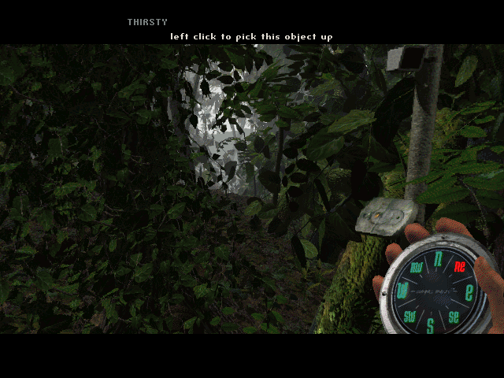

*The compass in the hand. The help hint at the top says what the pointer will do.*

* **Fruit, flowers, bark and tubers** go straight to the inventory bar instead of your hand.
* Heavy things need energy: an object heavier than 3 needs at least that much ("too weak to pick it up"), and your energy
  minus what you already carry must still cover it ("can't carry any more").
* **Fruit you drop rots away** and cannot be picked up again.

### 4.2 The keys for your hands

| key | does |
|---|---|
| **S** | stash the held object on the inventory bar (with nothing in hand: take off the first thing you wear) |
| **D** | drop the held object into the nearest free spot that accepts it ("no space to drop it" if there is none); over the bar: drop the object under the pointer |
| **Space** | use the held object; over the bar: use the object under the pointer |
| **Shift** | toggle bar mode (below) |

### 4.3 Using an object on the world

Hold the object, put the pointer over the target (a lock, a machine slot) and press **Space**. If the target accepts it,
the use happens; otherwise nothing does. With no target, **Space** uses the object on yourself: a drink is drunk, a pill
swallowed.

### 4.4 Wearing

Some objects can be worn (goggles, a mask, a poncho). Hold one and press **Space**. You can wear up to three things. A worn
object stays on the bar with a "worn" icon; click it, or press **S** with an empty hand, to take it off. You cannot eat
or drink with a mask on.

### 4.5 The bar at the bottom

The bar along the bottom edge holds everything you stash and every fruit you pick. Press **Shift** to enter bar mode:
the pointer moves to the bar and mouse movement slides the strip left and right. Press **Shift** again to leave it.

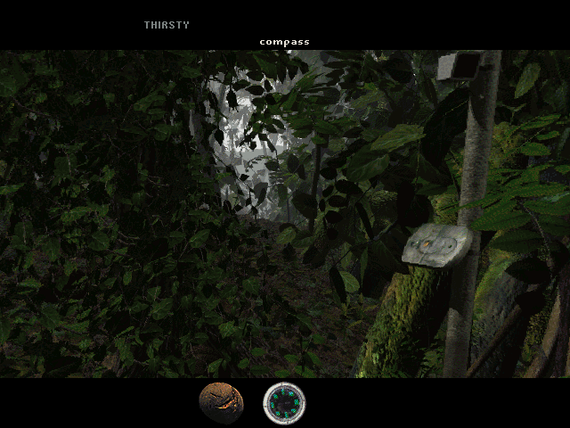

*Bar mode. The name of the object under the pointer is shown at the top.*

* **Left-click** an icon to take that object into your hand. For **fruit**, a click (or **Space**) eats it.
* **Space** over an icon uses or eats it directly; **D** over an icon drops it.
* Identical objects share one slot; a number in the corner shows the count, and the oldest one comes out first.

---

## 5. Your body

The game tracks your body in numbers you can read on two screens and in warnings at the top of the picture.

### 5.1 The status screens

* **Tab** (hold it): the **personal status screen**: energy, health, body temperature, hydration, nutrition, symptoms,
  when you last slept, ate and drank, and the **sleep** and **rest** buttons. The game shows it while the key is held.
* **Caps Lock** or the **backquote key** (`, the one beside the left Shift key on most keyboards): the **plant and
  environment screen** (section 7): the plant under the pointer, the words for air, soil, wind, pollution and humidity where
  you stand, and the biome's health. It does not open in houses, basements, tunnels or Club Eden, nor with goggles on.
  The game shows it while the key is *held*. A Mac keyboard cannot hold Caps Lock (it is a switch), so here the screen is
  open **while the Caps Lock light is on**: switch Caps Lock on to look, off to close the screen. The backquote key
  works like Tab: hold it, release it. (With Caps Lock left on the screen is always up, and any typing of capital letters
  looks odd on the page behind it; the screen is not shown while a menu or a text entry is open.)

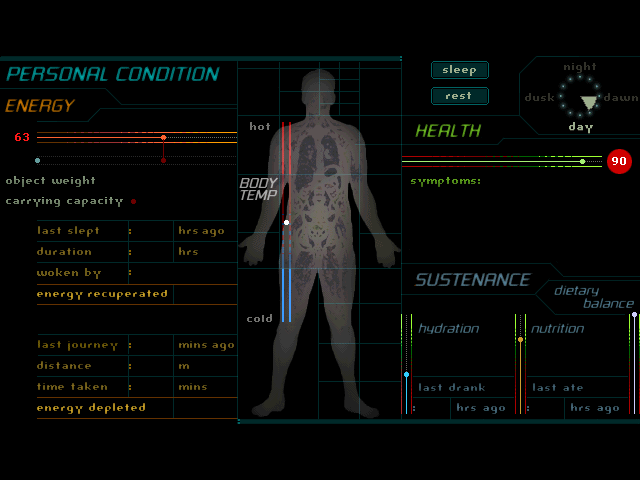

*The personal status screen (Tab). Energy, body temperature, health, hydration and nutrition are the gauges.*

### 5.2 Warnings

Your body speaks up in words at the top of the picture:

| word | meaning |
|---|---|
| HUNGRY | nutrition below about 45 (very low below 20) |
| THIRSTY | hydration below 40 (very low below 20) |
| TIRED | energy below about 22 (very low below 10) |
| COLD / HOT | body temperature below 40 or above 65 on the gauge (about 27 / 73 and you take damage) |
| SICK, DYING | health below 30, below 10 |

### 5.3 The rhythm of drinking and eating

A new game starts with you already thirsty (hydration about 40). Drink first.

* **Water** is the basic need. You lose about 4 points of hydration per game hour at a mild temperature (20 degrees C
  or below), and a drink gives about 20. So you need a drink about every **5 game hours** (12 minutes of real time) when it
  is mild.
* **Heat** makes it worse. Every degree above 20 adds about 0.4 points per hour: at 30 degrees you lose about 8 points an
  hour (a drink every 2.4 hours, about 6 real minutes); at 35 degrees about 10 (every 2 hours).
* **Food**: nutrition drops about 6 points per game hour. Foods give anywhere from about 10 to 100 points (a coconut is the
  biggest), so a good meal lasts several hours. Below about 45 you also lose energy faster. Raw meat and fish give only
  a fifth of their value; cooking helps.
* Your body temperature follows the air temperature (rain cools you; a poncho or sleeping bag warms you). While you are
  hydrated you sweat and stay below the damage line. Drinking cools you a little.
* Staying awake more than 24 hours drains energy quickly.

When THIRSTY appears, drink at once; hunger can wait longer than thirst.

### 5.4 Sleep and rest

Hold **Tab**, move the pointer to **sleep** and click.

* You can only sleep when your energy is 80 or lower, and not right after waking up.
* A night's sleep lasts 3 to 6 game hours on the ground, longer in a bed or sleeping bag, and gives back energy and some
  health. A bed gives the best sleep (the energy limit is raised from 80 to 100).
* Sleep is cut short by an overheated or freezing body, a coughing fit, or rain on an unsheltered spot. The game checks
  every 90 game seconds, so **at the start, in the open rainforest, where it is raining, you wake after one check (90 game
  seconds) with hardly any rest**. That is how the original works, not a fault of the port. The rule: while it rains where
  you are (thin rain streaks fall over the picture and you hear it) and the spot has no roof, you wake at the next check,
  unless a sleeping pill is working. (If your energy is 20 or less when you lie down, you sleep on until the sleep has raised it
  above 20, about two hours, and then you wake.) The hut in the rainforest, the baobab in the savannah and the cave of the dead
  biome are roofed, and so is any place where no rain machine is running. Sleep there, or wait for the rain to stop.
* Some rooms do not allow sleep at all ("can't sleep").
* The **rest** button skips one game hour and restores a tenth of what you are missing.
* When you wake, you may have dreamed.

### 5.5 Illness and poison

Bad water, raw food, bites, fumes, certain plants and drink can make you ill. The personal status screen lists symptoms in
the game's words (queasy, stomach cramps, chills/sweats, breathing difficulty, blistered hand, hungover, ...). Each
symptom lowers the **highest health you can reach** while it lasts. Most can be cured with something from the
biosphere or the dispensary; some wear off. A fever illness shows nothing for about a day after you catch it. A medical
scanner somewhere in the complex analyses blood and breath. Cures are in Appendix B.

### 5.6 What kills you

You die when health reaches zero: dehydration, starvation, too hot or too cold, too little oxygen (below about 14 percent
without a mask), fumes, infection, poison, and a few hazards in the machine rooms. The death screen says which. After it,
press **Esc** and load a saved game.

---

## 6. The biosphere

### 6.1 The biomes

The complex is built from zones that each have their own air, soil and climate:

* **Rainforest**: warm and humid, the first place you see.
* **Savannah**: dry grassland and desert sites, cold at night.
* **Ocean**: a saltwater tank with a beach on top and underwater sites below.
* **Evolution**: a biome that starts dead and can be brought back to life ("the evolution biome is regrowing...").
* **Club Eden** and **the house**: two areas for people, each on its own power circuit.
* **Basements, tunnels and lungs**: machine rooms, passages and big air bellows that join the biomes.

Outside, the weather drifts: day highs between about 16 and 25 degrees, night lows from about -6 to 0, changing wind and cloud.

### 6.2 Air

Each biome is split into boxes of air that mix with their neighbours; fans push air through the soil beds. Air has
temperature, humidity, oxygen, carbon dioxide and pollution. Plants take in carbon dioxide and release oxygen by day and
breathe the other way at night. The **lungs** are bellows that move air between biomes. The **hatches** and **seals** open or
close the passages between sections; air, and whatever is in it, flows through them once they are open.

### 6.3 Water

Water lives in tanks that feed each other. Rain drains through the soil layers into each biome's main basement tank; a
reverse-osmosis unit turns it into **clean** water for the rain and mist machines; water that condenses from the air
collects in a **condensate** tank; a UV unit makes **pure** (drinking) water. Pumps move water between the four main tanks,
and drains clog with silt unless the filter scrubbers work. Soil water runs from 1 (dry) to 47.5 (flooded); the rainforest's
opening flood is just above full.

### 6.4 Power

A solar panel and a windmill charge a store of energy that every running machine draws on. If it runs dry the complex
blacks out and restarts only after the store has recovered a little. Machines hang on **fuse boxes**, one per biome; a
fuse that is out stops the machines on it. A fire in a fuse room pollutes the air.

### 6.5 What the machines are for

The game names these systems on its control screens:

| system | what it does |
|---|---|
| heaters | keep a biome inside its temperature band; among the biggest power users |
| rain machines, misters | wet the soil and the air from the clean tank |
| reverse osmosis, UV, filter scrubbers | make water clean, pure and keep drains open |
| water pumps | move water between biome tanks |
| air mixers, soil-bed fans, circulatory fans, air pumps | stir air, push it through soil, move it between boxes |
| tide machine, wave machine, bubbler, algae scrubber, oxygen extractor | keep the ocean alive (oxygen, algae, level) |
| lifts, pod controls | travel |
| sensors | measure; they raise alarms |
| lights | basement lighting |

Machines run on a daily timer (many default to a window of a few hours) or by hand, set at the machine or at a terminal
(section 8).

### 6.6 How neglect shows

A site is drawn in a **healthy**, **dead** or **flooded** variant depending on plant health, soil water and, underwater,
the ocean's health. Plants wilt and die, fruit stops, the savannah greens after rain and browns when it dries. The
terminal's health map (section 8.3) and the plant screen's biome health bar show the same as numbers.

### 6.7 What you are expected to run

Left alone, the biosphere does not hold: soil dries, the rainforest runs out of clean water within a week, the ocean's algae
outgrow the scrubber's default hour a day, and plants die slowly. You are expected to read the sensors, supply water and
heat where they are short, and keep power in balance.

---

## 7. Plants

Hold **Caps Lock** (or the backquote key; see 5.1) with the pointer on a plant (or on its close-up page) to read its status
screen.

| screen element | meaning |
|---|---|
| species | the plant's name |
| condition | healthy, unhappy, dying, dead, or recovering / regrowing; the coloured gauge beside it is health |
| problem lines | polluted, too dry, too wet, losing water, too hot, too cold |
| leaf temperature | gauge; the plant has an ideal range |
| last watered | days since rain reached it |
| water uptake, transpiration | how well it is drinking; "cooling plant" when it sweats |
| photosynthesis | the current rate; "stomata closed" when it has shut down |
| fruit line | no fruit, fruit growing, has fruit, flowers growing, flowering |

On the right side the screen shows the **biome health** as a percentage and a gauge, and six words for where you are:
air temperature (cold ... hot), soil (very dry ... waterlogged), wind, pollution (clean, polluted, badly polluted) and
humidity (very dry air ... very humid).

**What plants need:** soil water inside their range, a leaf temperature near their ideal, clean air (pollution above about
10 percent hurts), light and carbon dioxide. Health falls quickly when something is wrong and recovers slowly: short-term
health comes back within hours, long-term health over days. Different plants like different soil water.

**Fruit:** a healthy plant (health above 0.4) grows fruit and regrows it some time after you picked it, if you are not
standing there watching. Fruit you pick goes to the bar; eat it or keep it. Raw tubers, some leaves and some seeds can
make you ill; cooking changes some of them. Which plant does what is for you to find out (Appendix B lists it).

---

## 8. The BioSys 4 terminal

BioSys 4 is the in-game computer: the control room for sensors, machine settings, power and the story's mail. It takes
over the whole screen.

### 8.1 Reaching it

A terminal button sits in the basement of each biome and in the house. The first time, the terminal asks for a password
(Appendix B): type it and press Enter. A wrong one clears the field. **QUIT** at the top right returns you to the page
you came from. The game clock keeps running meanwhile.

### 8.2 The screen

* top left: the game's time and date;
* top right: three **power gauges** (consumed, generated, reserve, with kW values) and four small icons that lead to the
  synthetic-plant files, the field notes, the mail and the species database;
* the **left column**: transport (the pod), health, systems (air, power, water), sensor readings (air, soil, ocean) and
  weather (inside, outside);
* the middle: a map of the biosphere with the four biomes;
* the lower part: the pages of the chosen topic.

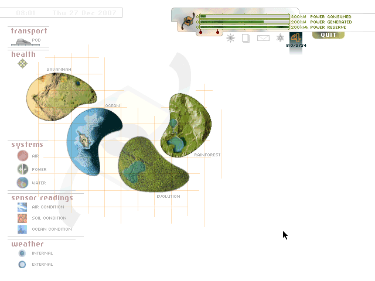

*The overview page.*

You use the left mouse button; actions happen when you release it. The right button does nothing here.

### 8.3 The kinds of screens

* **Health map**: the four biomes drawn as islands; a biome in grey is dead.

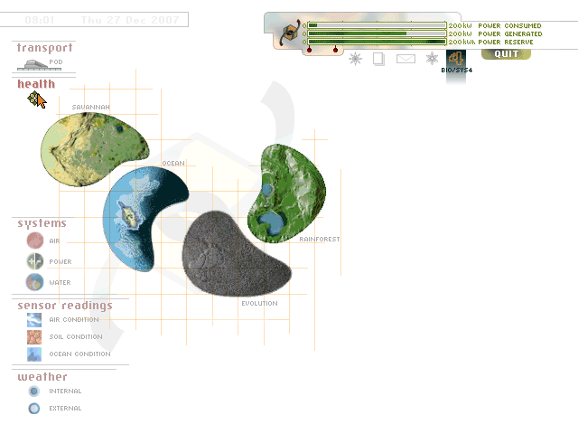

*The health map.*

* **Sensor pages** (air, soil, ocean, weather): choose a quantity at the bottom (CO2, humidity, pressure, temperature,
  pollution, oxygen, ...). Each probe is a ring on the map; click one to read it. Red marks and "dangerous levels detected
  for this parameter" show readings out of range.

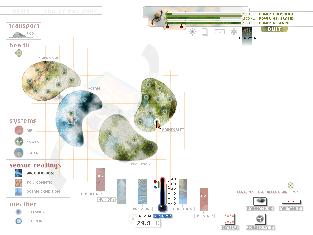

*A sensor page: probe RF/04 reads 29.8 C. The thermometer scale runs from -10 to 40.*

* **Device panels**: choose a system on the left (air, power, water), then a device on the map; a panel opens on the right
  with its buttons and sliders. Rain machines, misters, fans, heaters, pumps, scrubbers, the bubbler and the hatches have one.
* **Spec sheets**: a technical description of a device, opened with the round **TECH** button at the top of its panel.
* **Power terminals** (one per biome and the house): a list of every machine on that biome's circuit with its power use.
* **Mail, species database and notes**: story text. Mail arrives during the game; an envelope mark tells you.

### 8.4 Reading a gauge

A gauge is a bar with its value written beside it; the bar fills in proportion to the value's range. The three power gauges
run from 0 to 200, the air-temperature thermometer from -10 to 40. Values refresh about once a second.

### 8.5 Setting a device

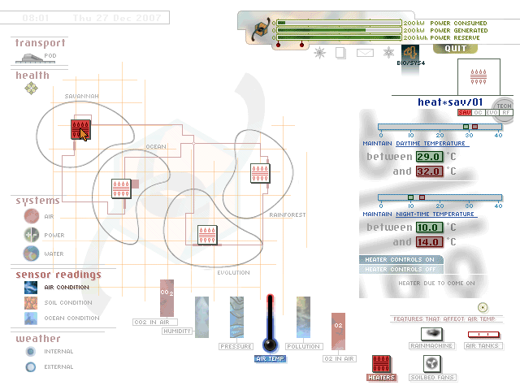

*The heater panel: the sliders set when the heater switches on and off.*

* **ON / OFF buttons** switch the device. It runs only while it has power; a lit symbol on the map shows when it does.
* **Schedule slider** (rain machines, circulatory fans, scrubbers, bubbler): two markers on a 24-hour bar, for the start and
  stop times (one pixel is ten minutes), shown in the green and red boxes. It applies when you release the mouse button.
* **Range slider** (heaters, misters): two markers set the on and off value, for example a heater's day and night
  temperatures. The heater switches on below the first value and off above the second.
* **Time-limit slider** (soil-bed fans): one marker; the fan runs for that long.
* **Source buttons**: where a rain machine takes its water (reverse osmosis or condensate), a bubbler its gas, a lung its air.

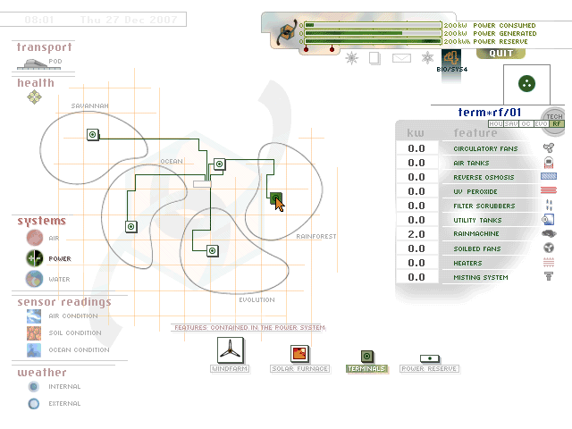

*A power terminal: the rainforest circuit; here only the rain machine draws power (2.0).*

---

## 9. Remaster settings

The port adds two independent settings. **Both default to the original game's behaviour**, so `--game` alone plays
the 1998 game (with its bugs; section 10).
Picture, sound and comfort can also be improved without touching the game's rules; all of it is off by default:

| what | option | section |
|---|---|---|
| panoramas at the window's resolution, gliding view | `--panorama smooth` | 9.4 |
| the pace of zooms, turning and fades | `--pass-ms N` | 9.5 |
| pause in the background, mouse sensitivity | `--pause-on-focus-loss`, `--mouse-sensitivity` | 9.6 |
| the game's own text at the window's resolution | `--text sharp` | 9.7 |
| panoramas across the whole width of a wide window | `--widescreen` | 9.8 |
| pictures without the dither pattern, enlarged smoothly | `--picture clean` | 9.9 |
| cleaner conversion of the sounds, volume groups | `--audio enhanced`, `--volume...` | 1.4 |
| autosave, more save slots, preferences file | `--autosave...`, `--save-pages` | 1.6, 1.7 |

A good "everything on" start for a wide screen is
`build/biosys --game --picture clean --widescreen --audio enhanced --fullscreen`.

**Day and night.** The light of a place changes with the hour by mixing the palettes of night, dawn, day, dusk and cloud a
little at a time, as the 1998 game does. Measured, no step changes a colour by more than 2 of 255, so the change is already
continuous and the port adds nothing to it. The one exception is the original's own: the close-up pages of a few machines
(a lift, a gate, a hatch, a cabinet) switch their light in one step half-way through.

### 9.1 Realism: `--realism`

| level | what it is |
|---|---|
| `faithful` (default) | the original, bug for bug |
| `corrected` | repairs the original's evident bugs and three model errors |
| `closedloop` | `corrected` plus a closed water and humidity cycle |

**`corrected`** also changes three things you can notice:

* the **protein** bar falls at a real rate (100 to about 20 in 10 days); in the original it hardly moves, so vitamins and
  varied food never mattered;
* the savannah's soil-water alarm moves from 4 to 7, where its plants start to suffer (an alarm only);
* the ocean's wave machine aims at the ocean's proper oxygen level (4.3 instead of 3.4, below the damage limit).

**`closedloop`** adds a humidity loop: soil evaporates, plants transpire, condensation returns the water.

* In `faithful` and `corrected` the rainforest air dries out within days and nothing puts the vapour back (measured on an idle
  world: 0.0002 percent on day 10). In `closedloop` it holds about 85 percent while the soil has water, then about 54 percent
  on day 10 and 30 percent on day 30 if nothing is done.
* **Irrigation makes a biome humid.** A savannah whose rain machines run daily has wet soil, evaporates and transpires, so it
  stays near 55 percent and its dryness alarm (limit 20) stays on; in the original it drops to 3 to 20 percent. That is the
  model's consequence, not a bug: the alarm says "over-watered".
* Dead plants no longer breathe oxygen away; the house keeps its warmth much longer with the heating off.
* **Flooded soil starves a plant of water uptake** the way dry soil does, mirrored: full uptake at the wettest soil the plant
  likes, none at standing water. In the original a slip in the formula made flooding *help*. The flat damage a flood does is
  unchanged.

No level changes this: left on its saved schedule, the ocean dies around day 8 (the algae outgrow the scrubber's one hour a day).

### 9.2 Difficulty: `--difficulty`

Difficulty scales the pressure on you with plain multipliers (the "timed threat" row is explained in Appendix B).

| | `guided` | `original` (default) | `survivor` |
|---|---|---|---|
| start hydration / nutrition / energy | 80 / 90 / 90 | saved: 40 / 75 / 63 | saved |
| thirst and hunger drain | half | as 1998 | 25 percent faster |
| damage from thirst, hunger, heat, cold, thin air | half | as 1998 | 50 percent more |
| awake limit before energy drains | 36 h | 24 h | 24 h |
| healing, sleep healing | 1.5 times | as 1998 | 0.75 times |
| plant damage | half | as 1998 | 25 percent more |
| solar and wind power | 1.5 times | as 1998 | 0.8 times |
| timed threat from outside | after 14 days | 7 days | 5 days |
| sensor noise | normal | normal | 5 times |

**An idle player** (no action at all, new game) dies of dehydration after about 5 game days on `guided` (4.8 to 5.5 in my
runs: the length of the nights it collapses into is random), 1.7 on `original` and 1.1 on `survivor`; the realism level does
not change this. A player who does nothing also passes out when the energy reaches zero, sleeps (in the rain only for two
hours at a time, see 5.4) and gets up again. A simulated careful
player survives eight days on every level, drinking about every 9 hours on `guided` and every 3.4 on `survivor`.

### 9.3 A first play

Start with `--realism corrected --difficulty guided`. `guided` gives you room to learn, and `corrected` removes the
original's worst bugs while keeping its rules. Move to `original` when you want the 1998 pressure.

**Be aware:** the realism levels were *measured* (30 simulated game days, five random seeds) but are **not yet play-tested for
long**. `closedloop` changes the humidity of every biome and can be harder than the original. The balance of `guided` and
`survivor` is likewise unproven by real play. Numbers and method: [SETTINGS.md](SETTINGS.md).

### 9.4 Smooth panoramas: `--panorama smooth`

The 1998 game draws a panorama at 640 x 368 pixels and turns it in whole pixels. In a large window the picture is then simply
enlarged: blocky, and the turning moves in visible steps. With `--panorama smooth` the panorama view is drawn at the window's
real resolution instead: the same cylinder and the same picture, with soft filtering (`--panorama-filter nearest` keeps hard
pixels) and a view that glides between the game's own scroll steps. Everything else is unchanged: the game's rules, where
things are and what a click hits, and everything drawn over the panorama (the held object, animations, goggles, rain, text,
the bars and the pointer) looks exactly as before, because it is the usual 640 x 480 picture laid over the smooth one.
It does not create detail the artwork does not have; it removes the coarse pixel grid and the steps. It works at every window
size and in `--fullscreen`.

The glide follows the game's scroll (one step per game step, section 9.5) by at most one step and never overshoots, and it
also runs through the zoom animations of close-ups, page changes and big jumps, so a zoom looks continuous. Close-ups, menus and machine pages are not panoramas and
look as before. With `--dev`, **F3** switches smooth and original panoramas while playing and **F4** the filter. The picture
was checked against an independent calculation (`tests/test_smoothpano.sh`); how sharp and smooth it looks on your screen, and
how fast it runs at 4K, is for you to judge.

### 9.5 Pace: `--pass-ms`

The 1998 game did one step of everything per turn of its loop: one scroll step, one frame of a zoom, one step of a cross-fade or
a shake of the view. How fast that looked depended on the machine and its monitor. This port runs those steps at a fixed
interval on the real clock, `--pass-ms N` milliseconds (default 33, about 30 steps a second), whatever your display's refresh
rate: a 60, 120 or 144 Hz screen shows the same speed. The window still redraws at the display's rate in between, so the pointer
stays responsive and, with `--panorama smooth`, the view glides. Things the original timed by the clock (the delay of a palette
fade, the wait while you walk a path, the one-second flash of the bar, the movies, the animation delays) keep their own times.

The original's real pace is not recorded anywhere, so 33 ms is a choice from thin evidence: the wind-driven animations of the game
ask for frame delays no shorter than 33 ms, the object animations for 40 to 80 ms, and the manual's minimum machine is a Pentium
100 MHz. If the game feels too fast (zooms, turning, shaking), raise it, for example `--pass-ms 50`; if it feels sluggish or
choppy, lower it, for example `--pass-ms 20`. Animations whose delay is shorter than a step are shown once per step, so a very
high value also slows them down.

### 9.6 Comfort settings: pause and mouse sensitivity

**`--pause-on-focus-loss yes|no`** (default `yes`). The original game stops its sounds, movies, animations and its own clock when
its window is not the active one or is minimised, and goes on when it is active again; the port does the same, so a game left in
the background does not run (and does not starve you) behind your back. With `no` a window that has only lost the focus keeps
running, for example beside another program; a **minimised** window is paused either way, because the original does nothing then
(its movie commands answer "inactive" and its idle step is skipped). The window title says "paused" while it is paused.

**`--mouse-sensitivity F`** (0.25 to 4, default 1). A factor on the mouse movement that turns a panorama while the pointer is
captured. At 2 the view turns twice as far for the same movement of the mouse, at 0.5 half as far; the movement that is rounded off
is carried over, so slow movements at 0.25 are not lost. Nothing else changes: the bar scrolling, the menus and free-pointer mode
use the pointer as before.

### 9.7 Sharp text: `--text sharp`

The game's own text (the words and messages in the top bar, the numbers on the status screens, the readings of the machine
displays, the names in the save and load menus, text you type, and the clock and numbers of the BioSys 4 terminal) is drawn in
1998 by the program onto the 640 x 480 picture, so in a large window its letters are enlarged in blocks. With `--text sharp`
the same letters are drawn again at the window's real resolution, smooth-edged, in the same font and size, in the same place and
the same colour: line ends, centring and right alignment are those of the 640 x 480 layout, only the shapes are sharp. The
picture under the text stays the usual enlarged one, and whatever the original draws over text (a moving animation, a window)
still covers it. The words that the 1998 game paints into the pictures themselves (most labels) are part of the
artwork and stay as they are; so does text written on a panorama page itself, which turns with the view (a few readouts when
you stand in the open). The setting is read when the game starts (it has no key). Without it nothing changes at all.
The placement and weight of the sharp letters were checked against the original frame without a window
(`tests/test_sharptext.sh`); how they look on your screen, and whether the sharp text sits well on the smooth panoramas,
are for you to judge.

### 9.8 Widescreen panoramas: `--widescreen`

In a window wider than 4:3 the game is shown centred with black bars. With `--widescreen` (or `widescreen = yes` in the preferences file;
it implies `--panorama smooth`) the **panorama view** uses the full width instead: the centre 640 columns are exactly the smooth picture
you would see without the option, and the extra columns on both sides show more of the same panorama, so you see further to the left and
right (about 91 degrees instead of 75 in a 16:9 window). The top bar and the inventory bar keep their size and stay in the middle.

The side areas are **for looking only**: the game knows only the middle part, so the pointer stays inside it and clicks happen there; when you
turn, things drift through the sides into the middle. Rain continues across the sides. The view never shows more than 110 degrees: a 21:9 screen
(3440 x 1440) is filled from side to side at 108 degrees, with soft edges; only a still wider screen gets black strips at the far sides.
The black above and below the panorama is the game's own top bar and inventory bar, which are black while they are empty. A few things fall back to the usual 4:3 picture, with black bars: close-ups, menus, the
terminal, movies, cross-fades; and, while it lasts, any view where something drawn over the panorama reaches the edge (worn goggles, the
Caps Lock environment screen). An object in your hand does not count: the hand (the compass, for example) is drawn where the original draws
it, cut at the right border of the middle 640 columns, and it no longer keeps the picture at 4:3 or stops it from coming back. The personal
status screen (Tab) keeps the picture as it is: the middle shows the status picture, the sides keep showing the panorama, dimmed to 40 %
so that the panel is the focus, and when you let go the picture is exactly as it was (no 4:3 frames, no colour change in the panorama,
also with `--picture clean`). The picture returns to wide a moment after the cause of a fallback has gone (a short delay so that nothing flickers). On the four transit-tube
panoramas (T1, T6, T7, T12) the game limits how far you can turn because the artwork beyond is not meant to be seen: the wide view narrows
smoothly as you approach those limits, so that nothing beyond them is ever shown (at the limit it is the 4:3 picture). With `--dev`, **F7**
switches widescreen on and off. Checked against an independent calculation without a window (`tests/test_widescreen.sh`); how it looks at your
window size and how the sides feel is for you to judge.

### 9.10 The picture over the whole window: `--interface overlay`

The 1998 screen is a picture of 640 x 368 between two black bars of 56 rows: the top bar carries the five status words and the line of
messages, the bottom bar your objects. On a wide screen both bars stay black while they are empty, which is most of the time.
With `--interface overlay` (or `interface = overlay` in the preferences file, or the **Interface** row of the Picture tab of the settings
menu, which takes effect at once; it implies `--panorama smooth` and `--widescreen`) the picture fills the window and the two bars become
things that appear over it only when they have something to show.

* **The picture.** On every page that has the 368-row view (panoramas and the close-ups of that height) the view is scaled by
  the window's height divided by 368 (3.91 on a 3440 x 1440 screen), which is not a whole number, and centred. A panorama
  shows as much of the cylinder as the window's width allows (about 93 degrees at 3440 x 1440, 76 at 1920 x 1080; the cap of 110 degrees of
  section 9.8 applies; the picture is that much taller than in 9.8, so the same width shows less of the cylinder). Everything drawn in the view grows with it: the object in your hand, what you wear, rain, status
  windows, animations and zooms. Where a close-up leaves empty sides, and on a panorama while the wide view has stepped back to 4:3
  (worn goggles, a big status window), the sides are filled with the picture itself, strongly blurred and dimmed to about a third,
  with a short soft gradient where it meets the picture, instead of black. Pages that fill the whole 640 x 480 (the menus, the title,
  the BioSys 4 terminal, the films and the frozen frame in front of a menu) are drawn exactly as without the option. In a window
  that is not wider than 640:368 (a 4:3 window) the picture is as wide as the window and black remains above and below; the overlays
  sit at the window's edges there, so it looks like the 1998 layout.
* **The status words** (nutrition, hydration, energy, temperature, health) are drawn at the top of the window in the places the game puts them
  (on a 640-wide grid centred in the window), at an interface size of 0.75 x the window height / 480 rounded (2 at 1080 and 1440 rows),
  with a dark outline and a soft dark halo and no bar behind them. They are shown whenever the game shows them.
* **The message line** (object names, hints, messages; the game clears it after about three seconds) sits at the bottom centre like a
  subtitle, just above the place of the strip, with the same outline and halo; it fades in over about a tenth of a second and out over
  a quarter.
* **The inventory strip** is the 1998 bar at the same interface size, at the bottom centre over a dark gradient, with the icons
  drawn directly on the picture (the black around an icon is see-through). It shows while you are in bar mode (**Shift**), for the
  second after you pick something up, and while the pointer is in the bar rows; otherwise it fades out. (The 1998 bar stays once it
  has been entered; here it goes away again.) Stack counts are as before.
* **The pointer.** While you look around it is held in the middle of the window, which is the middle of the view. In bar mode it is shown in the
  middle of the strip. With **Ctrl** (free pointer) it moves over the view, which maps linearly to the window; pushed against the bottom edge
  of the window it enters the bar rows by itself, like a dock. Clicks hit exactly what they hit in the 1998 layout, since the game
  still sees the 640 x 480 screen; the mouse moves the view by the distance it moves in view pixels, so a
  large window does not make the mouse faster. When you turn up or down past the end of a tall panorama the pointer is released
  vertically as before; when it passes the bottom of the view the pointer you see jumps into the strip.
* **Not combined:** with `--picture clean` the panoramas are cleaned as usual, but the flat pages and close-ups are enlarged plainly in this
  layout (the cleaner works on whole-number enlargements of the 640 x 480 frame).

How it looks and feels on your own screen is for you to judge: the size of the words and of the strip, whether the dark halo is enough on
your brightest scenes, whether the blurred sides of a close-up are pleasant or distracting, how the pointer feels at the bottom edge. The
numbers (layout, pointer maps, the panorama pixels against the exact cylinder, text contrast on a bright sky) are checked by
`tests/test_overlay.sh`; the pictures `build/shots/full_*` are made by it.

### 9.9 Clean pictures: `--picture clean`

The pictures of the 1998 game are 256-colour renders, and the way to fake more colours was dither: a sky, mist, grass or brushed metal is
made of two or three close colours that alternate in a fine checker pattern. The window enlarges every picture pixel as a block, so that
pattern is what you see in a big window. With `--picture clean` (or `picture = clean` in the preferences file; it implies
`--panorama smooth` and `--text sharp`) the program takes the pattern out wherever the picture's own colours say that it is dither, and
enlarges the result smoothly (Catmull-Rom, an interpolation that keeps edges sharp) instead of in blocks. The setting is read when the
game starts. Without it nothing changes at all: the game, the saved games and the 640 x 480 picture the game keeps are the same.

**What it does**

* *Panoramas.* The whole 2560 x 1024 page is cleaned (also across the seam where the picture wraps round) and then shown through the
  smooth panorama of section 9.4, also in the side areas of `--widescreen`. The cleaned page is kept at twice its size, so a large
  window still gets crisp edges.
* *Everything else.* Close-ups, flat pages, the top and bottom bars, the status windows, the held object, the fixed animations, the
  worn goggles and the rain over a panorama are cleaned and enlarged to the window's scale (up to 4; beyond that the window's own
  filter does the last step). Objects and overlays get soft, anti-aliased edges, without a ring of the cyan key colour or a dark fringe.
* *The BioSys 4 terminal and the films.* No dither is taken out of them (their grain is texture, the lines are thin) and they are only
  enlarged, with the same smooth filter. The pixel typeface of the terminal's artwork is therefore rounded at its corners; the clock
  and numbers are drawn by the sharp text. The cursor is your computer's cursor and stays as it is.
* *How it decides.* A pixel is smoothed only when a 2 x 2 block around it holds colours that are close to its own (close = the palette
  colours differ by less than a threshold, about 14 steps of 255 at full daylight, less at night). Thin lines, lettering painted into the
  picture and edges have no such block and are left alone. The threshold shrinks with the palette's contrast, so the dark of night is
  smoothed more gently.
* *Dawn and dusk.* While the light changes, the colours of the dither pairs move a little every half second, and a patch of sky would
  switch from dithered to smooth in one step and back again. Measured on a full sunrise and sunset on two sky pages (the game's own
  palettes at every step), that happens: in up to 485 of 1137 steps hundreds of thousands of pixels flipped, and the cleaned picture
  jumped by up to 25 grey levels in one step where the uncleaned one moves by 1. The remedy is that the decision fades: a pair of colours
  that crosses the threshold changes from dithered to smooth over some seconds, one 32nd of the way each step (a new place, the lights or
  the goggles take the decision at once). The same sequences then jump by at most 5 grey levels, and no step has even 50 pixels that
  jump 3 levels more than the uncleaned picture (tests/test_picclean.sh, part E, the numbers are printed there).

**What it cannot do**

It does not invent detail: grass blades, bark and texture that the dither carried are smoothed, not redrawn, so grass and foliage look
softer than today, and diagonal edges (a truss, a branch) keep their staircase, only rounded. Dither whose two colours are far apart
(the red bars, the red logo, isolated bright specks) is left as it is. Lettering painted into a picture is left alone as far as possible, but
very fine, anti-aliased lettering can lose a little contrast (the trial measured 9 % on average in the worst sample). A cleaned picture follows a change of the palette with a fraction of a second's delay, and a panorama
you have just entered is shown for a moment (about a tenth of a second) as the plain smooth panorama before the cleaned page replaces it.

**What it costs**

Two extra threads clean the pictures, so nothing in the game or in the frame rate waits for them (on the author's machine one full
refresh of a panorama page takes about 60 ms of one core, about twice a second while the sun rises or sets, and a frame about 9 ms
at 3x whenever it changes). Memory: roughly 100 MB, of it a 42 MB texture on the graphics card. `--clean-texture 1` keeps the panorama texture
at 1x (a quarter of the work and memory, slightly softer edges at large window sizes). How the clean pictures look on your screen, whether
the smoothing of grass and foliage is too much, and whether the fade at dawn and dusk is noticeable at all, are for you to judge; the
comparison pictures `build/shots/clean_*` (today, smooth panorama only, clean) are made by the test.

---

## 10. Differences from the 1998 release and known limits

### 10.1 What is the same

* The rules are a translation of the original game code, constant for constant. With `--realism faithful --difficulty original`
  the game is meant to behave exactly like the original, including its quirks.
* Saved games use the original's file format (the engine part and the game part, same layout and version number); the
  settings of a save are kept in a block appended after the original's two parts (section 1.4). The
  new game itself is an original-format save and loads. I could not run the original program here, so saves made by the
  port have not been loaded in the original, nor original saves made by other people in the port.

### 10.2 What the realism levels repair

The original has 30 known bugs, each a separate switch; `corrected` and `closedloop` repair 27 of them (the three of unclear
intent stay as they were). By kind (details and evidence: [FIXES.md](FIXES.md)):

* **Memory safety and loading** (10): reads of uninitialised or out-of-range data, and two machines (a lung, a hatch) whose
  state a saved game did not restore. Invisible in play.
* **Cosmetic** (7): a misplaced number on a panel, a sensor alarm effect that never stopped, a coffee machine sound that kept
  playing, the wrong picture for an emptied oxygen cylinder, a lift page that did not redraw, F1 typing into the cheat buffer.
* **Behaviour with evident intent** (10): ocean probe readings, plants' cold damage measured from the wrong minimum (plants die a
  little earlier: 5 more of 38 by day 30), rain that never washed pollution out of the air, lung commands, a demo exit that
  never quit, a third coffee that still gave water.

### 10.3 What the port does not do yet

* Study items A5 and A8 to A10 and a weather feedback are designed but not built (see SETTINGS.md). A further realism level
  ("living system") and a harder difficulty ("castaway") are designed and held back until the existing levels have been played.
* Not built: turning the view by dragging on a trackpad, translations, subtitles for the films, and machine-upscaled artwork
  (a trial exists; `--picture clean` is the light version of it).
* Long real-time play (days) has not been done.
* **Seen at a real window so far:** the game with smooth panoramas ran and played ("works well"); the first build ran its zooms
  and turning about twice too fast on a fast display, which the fixed pace of section 9.5 repaired. Which pace feels right (20,
  33 or 50 ms) is still open.
* **The settings menu and the New game screen (section 1.8)** were checked with scripts (model, keys, clicks, the pictures of
  every tab at 1280 x 960 and at 3440 x 1440 composed on the CPU, the preferences file, the save block) and with the program's own
  window code on SDL's dummy video and audio drivers with key and mouse events pushed through SDL. Nobody has seen them on a real
  screen: how they look and read at your window size and in full screen, whether the mouse feels right (the drag of a slider,
  the wheel), whether switching sharp text, clean pictures, the audio mode (the sound device is opened again) and the screen
  live is smooth on your machine, and what the audio switch sounds like, is for you to judge. Sharp text switched on while the
  game is running shows only text that the game draws afterwards; text already on the screen stays as it was until redrawn.
* **Checked without a window only:** everything else in sections 1.6, 1.7 and 9: the Caps Lock / backquote status screens, the
  full-screen switch, pause on losing the focus, mouse sensitivity, sharp text, widescreen, clean pictures, autosave and the
  preferences file were tested through scripts against independent calculations, with a faked clock where time matters. How
  they look and feel on your display (sharpness, the sides of the wide view, the softness of cleaned grass and foliage, the
  light at dawn and dusk, the speed at large window sizes) is for you to judge.
* **Held objects and the status screen in the wide pictures (sections 9.8 and 9.10)** were checked with scripts only (`tests/test_heldwide.sh`: the
  held image taken out of the frame and put back byte for byte, the picture staying wide with the compass held, the Tab screen with dimmed
  sides at 3440 x 1440, no re-cleaning of the panorama while it is up) and with the program's window code on SDL's dummy drivers. Nobody has seen
  them at a real window: how the dimmed sides look, whether the hand cut at the border of the middle columns bothers you, and whether
  the first frames after Tab are free of any colour flash with `--picture clean` is for you to judge.
* **The overlay interface (section 9.10)** was checked with scripts (layout and pointer arithmetic, the panorama against an independent
  calculation at 3440 x 1440, 1920 x 1080 and 1728 x 1084, the overlay states with fades, text contrast over a daytime sky, hit tests in both layouts,
  the vertical release) and with the program's own window code on SDL's dummy drivers, whose software renderer filters textures
  differently from a graphics card, so the window's picture was compared with the CPU composition by block means, not pixel
  for pixel. Nobody has seen it on a real screen; the strip and the ambient fill are drawn by code that only ran on the software renderer. The pointer at
  the bottom edge (the dock), the confinement of the pointer to the window and the feel of the mouse at a fractional scale were tested
  with scripted moves, not with a mouse.
* The sound was checked by measurement, not by ear; the movies were compared frame by frame against a reference decoder, not
  watched. The program is built for macOS; nothing was tested elsewhere.
* The game logic has no unfinished parts that the game reaches; the few `UNRESOLVED` marks in the source are for things nothing
  asks for (see `src/game/README.md`).

---

## Appendix A. Keys and mouse

| input | does |
|---|---|
| mouse movement | turn the view (panoramas) |
| left click | follow a path, look closer, pick up, use, press a control |
| right click | return from a close-up |
| Ctrl (hold) | free pointer |
| arrow keys | turn the view |
| S / D / Space | stash / drop / use (section 4.2) |
| Shift | bar mode on / off |
| Tab (hold) | personal status; while holding it, click **sleep** or **rest** |
| Caps Lock (on = held) | plant and environment status while the Caps Lock light is on (section 5.1) |
| ` (backquote, hold) | the same screen, held like Tab |
| Option+Return (Alt+Return) | full screen on / off (not while you are typing something) |
| Option+N | move the window to the next screen |
| Option+M | let go of the mouse (the game pauses); a click on the picture or Option+M again goes on |
| F1 | help hints on / off |
| F5, F6 | save page, load page |
| Page Down / Page Up, mouse wheel | next / previous page of slots in the save and load pages (section 1.6) |
| F9 (twice within 3 s) | load the newest autosave (not in a menu or a text entry) |
| - / = / \\ | master volume down / up, mute (not in a menu or a text entry) |
| F10 or Cmd+, | the settings menu (section 1.8); Esc, F10 or Close leaves it; not while you are typing something |
| Esc | main menu; leaves menus; skips intro parts |
| Y / N | answer a question in the menu |
| letters, digits, Enter, Backspace | password entry (pod, terminal) |

---

## Appendix B. Spoilers

### B.1 Passwords

> **SPOILER WARNING. This section gives away puzzle answers.**

Pod destinations ask for these the first time (type them in the pod console, case does not matter; the rainforest
basement needs none):

| destination | password |
|---|---|
| rainforest basement | LANDLADY (already entered) |
| savannah basement | VISITOR |
| ocean basement | RESIDE |
| Evolution basement | HIDDEN |
| house basement | HOUSE |

The BioSys 4 terminal asks for **RUSSELL** at its first page. The mail pages ask for **CYBERSPHERES** and the
synthetic-plant files for **GREENKING**.

### B.2 What the plants and things do

> **SPOILER WARNING. This section spoils most of the discovery of the plants and cures.**

* **Cures:** spider bite: da-bo-car. Breathing difficulty and smoke damage: bronchial inhaler or cooked ephedra
  (cooking turns raw ephedra into the active drug). Worms from still water: lombriguera latex. Raw manioc (prussic acid):
  cook it or take annatto. Raw yam (dioscorin): cook it. Giant hogweed burn: aloe vera. Malaria: chloroquine (a day of
  protection) or cinchona bark (three days). Hangover: coffee or a cooked egg.
* **Stimulants and trips:** coffee, guarana, coca, adrenaline (a second shot while the first is active kills you),
  white angel's trumpet and peyote (visions).
* **Poisons:** strychnos nux vomica, hedgehog cactus fluid, eating a dead baby synth (indigestion).
* **Food:** a coconut is richest (about 104 nutrition), then breadfruit 55, yam 48, watermelon 46, avocado 40; honey is 75 but
  costs bee stings. Corned beef never rots but adds salt: about six tins give palpitations.
* **Equipment:** goggles last 5 game hours per charge, a mask 20 hours; the mask also cancels synth attacks.
* **Danger:** putting a water fire extinguisher on a burning fuse box kills you (use the carbon dioxide type).
* **Time limit:** once the Evolution biome has recovered enough (average plant health above 0.3), a countdown of 7 game days
  starts (14 on `guided`, 5 on `survivor`); after it, a helicopter from the outside world hunts you in open places.

### B.3 Cheats

> **SPOILER WARNING. Cheats spoil the game and may break the balance. Use at your own risk.**

Type the word `SILVERFEATHER` (a chime confirms it), then any of these (each word clears after 2 seconds of no keys):
`TZING` restores your body; `HUNKYDORY` also restores the world; `IMMORTAL` pins your values; `FF` and `ZZ` skip one and
twelve hours; `SKIPnn` skips nn hours; `WATER`, `BANANA` give a drink or a snack; `GOTO<page>` then Enter teleports.
There are many more (sensor values, weather, milestones); see `analysis/notes/player.md` section 10. Cheat words are typed in the game window; the developer keys of Appendix B.4 are off unless you started with `--dev`, so the
letters of a cheat word do nothing else. (With `--dev` they do: G even swallows the keys that follow.)

### B.4 Developer keys (`--dev` only)

These are leftovers of the page viewer. They are **off** unless you start with `--dev`, because some of them can wreck a game:
**F2** starts a new game (losing the running one), **H** hotspot outlines, **O** hidden ornaments, **G** type a page name to
jump there, **[** and **]** previous and next page, **Backspace** back, **P** and **L** cycle palette sets, **1** to **6**
change the lighting time slot, **M** plays intro movies, **N** plays a test animation, **F3** / **F4** switch the smooth
panoramas and their filter (section 9.4). They are off while a menu, the terminal
or a text entry is open. The arrow keys that turn the view work without `--dev`.
