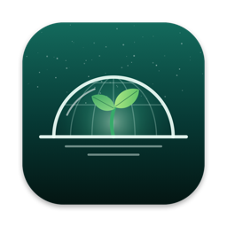
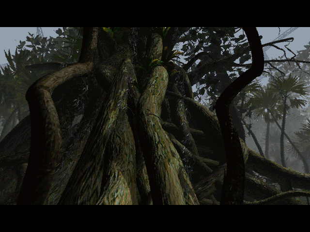
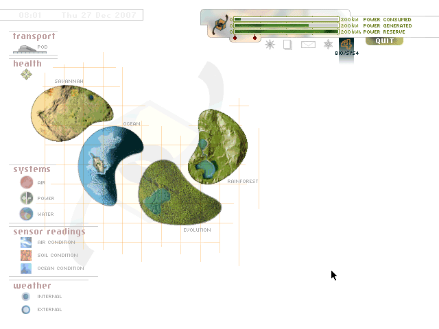

<p align="center">
  
</p>

<h1 align="center">Biosys Remaster</h1>

<p align="center">
  <b>A sealed world. One survivor. Every breath of air is something you have to grow.</b><br>
  The 1999 biosphere survival adventure, running natively on today's Macs.
</p>

<p align="center">
  <a href="https://github.com/biosys-fan/biosys-remaster/releases/latest"><b>Download for macOS</b></a>
  &nbsp;·&nbsp; <a href="#play-in-three-steps">How to play</a>
  &nbsp;·&nbsp; <a href="MANUAL.md">Manual</a>
  &nbsp;·&nbsp; <a href="DISCLAIMER.md">Disclaimer</a>
</p>

<p align="center">
  
  
</p>

---

You wake up inside a sealed glass biosphere with little memory of how you got there. Rainforest, savannah, ocean and
a small house share one closed atmosphere, and all of it is simulated: plants make the oxygen you breathe, the tide
moves, machines need power, and the weather outside does not care. Neglect the ocean and the air goes bad a week
later. Nothing tells you what to do. You work it out, or you do not last.

*Biosys* was made by JumpStart Solutions and published by Take-Two Interactive in 1999. It was years ahead of the
survival genre and was all but forgotten, partly because it stopped running on anything newer than Windows 98.

**Biosys Remaster is an unofficial homage that makes the game playable again**: a native re-implementation of the
game's engine and rules that reads the original data files. Started plainly, it is the original game, constant for
constant. Around that sit optional improvements you can switch on one by one.

> [!IMPORTANT]
> This project contains **no file of the original game**. You bring your own copy; the app shows you where to get it
> and takes it by drag and drop. It is a fan project, not affiliated with or endorsed by the original creators or
> rights holders. See the [disclaimer](DISCLAIMER.md).

## Play in three steps

1. **Download the app.** Get `Biosys-Remaster-…-macOS.dmg` from the [latest release](https://github.com/biosys-fan/biosys-remaster/releases/latest),
   open it and drag **Biosys Remaster** onto **Applications**. (Intel and Apple Silicon, macOS 11 or later.)
2. **Download the original game.** Open the app. Its start screen has a button that opens the game's page on
   [My Abandonware](https://www.myabandonware.com/game/biosys-f2f#downloads). Download both files there:
   **Game CD** (502 MB) and **Setup CD** (317 MB).
3. **Drop both files onto the app's window.** No unpacking, no installer, no emulator. The app checks the files,
   copies what it needs (about 1 GB) and starts the game. If your browser already unpacked the downloads, drop the
   folders instead; that works too.

That is all. From then on the app starts straight into the game.

<details>
<summary><b>macOS says the app cannot be opened or checked</b></summary>

The app is free and has no paid Apple developer signature, so macOS asks you to confirm it once:

1. Open the app once (macOS refuses), then open **System Settings › Privacy & Security**.
2. Scroll down to the message about "Biosys Remaster" and choose **Open Anyway**.

On macOS 14 and earlier you can instead right-click the app and choose **Open**. Either way you do it only once.
</details>

<details>
<summary><b>Where things are kept, and how to start over</b></summary>

Everything lives in `~/Library/Application Support/biosys/biosys/`: your saved games, the preferences file
`biosys.conf`, and the imported game data in `gamedata/`. Delete `gamedata` to make the app ask for the two files
again. Deleting the whole folder resets the app completely. The files you dropped are only read, never changed.
</details>

## What the remaster adds

Everything below is **optional and off by default**. Press **F10** (or **Cmd+,**) in the game for the settings menu;
changes apply at once and are remembered.

### Picture

| | |
|---|---|
| **Smooth panoramas** | The 360° views are drawn at your window's real resolution and glide instead of stepping. |
| **Widescreen** | Panoramas use the full width of a wide or ultrawide display. |
| **Clean pictures** | The 256-colour dither pattern is taken out of skies, mist and grass, and pictures are enlarged smoothly. |
| **Sharp text** | The game's own typeface, drawn at the window's resolution instead of enlarged pixels. |
| **Full-height interface** | The picture fills the window; messages, status and your objects appear over it only when needed. |
| **Full screen, several displays** | Option+Return switches full screen, Option+N moves the game to the next display. |

### Sound

| | |
|---|---|
| **Enhanced sound path** | The original 8-bit sounds are converted properly for modern devices, without the clicks at starts and stops. |
| **Volume groups** | Separate levels for the world, the films and the terminal, plus master volume and mute on keys. |

### Comfort

| | |
|---|---|
| **Autosave** | Three rotating autosaves: on a timer, when you wake up and when you quit. F9 twice loads the newest. |
| **More save slots** | 40 slots instead of 10, in the original menu's own style. Saves stay in the original file format. |
| **Settings menu** | Everything here in one in-game menu, stored in a plain, commented preferences file. |
| **Steady pace** | The game runs at the same speed on every display, and the pace is adjustable. |
| **Pause in the background** | The game stops when you switch away. Mouse sensitivity is adjustable. |

### The simulation: faithful, corrected, or closed loop

Chosen on the **New game** screen and stored inside each saved game.

| Realism | |
|---|---|
| **Faithful** (default) | The 1999 game, bug for bug. |
| **Corrected** | Repairs 27 of the original's 30 known bugs where the intent is evident, and three model errors: protein now matters, an alarm sits where plants actually suffer, the ocean's wave machine aims at a survivable oxygen level. |
| **Closed loop** | Corrected, plus a closed water and humidity cycle: soil evaporates, plants transpire, condensation returns the water. |

| Difficulty | |
|---|---|
| **Guided** | A gentler start, slower thirst and hunger, half damage, more time before the outside threat. |
| **Original** (default) | As in 1999. |
| **Survivor** | Faster drain, more damage, less power, noisy sensors. |

Every repaired bug is a named switch with its evidence in [FIXES.md](FIXES.md); the model changes and their measured
effects are in [SETTINGS.md](SETTINGS.md). The [manual](MANUAL.md) covers the whole game, the keys, and (behind
spoiler warnings) hints.

## State of the project

This is an early release, made by reading the original program very closely, not by guessing.

- The game rules are a translation of the original game code, kept constant for constant and checked by a large
  test suite against the original's data and tables. The whole game is implemented, including the BioSys 4 terminal,
  films, sound, saving and loading.
- Much of the remaster layer was verified by scripts and measurements rather than by long play sessions. Section 10
  of the [manual](MANUAL.md#10-differences-from-the-1998-release-and-known-limits) says exactly what has been seen on
  a real screen and what has not.
- macOS only for now. **Windows is planned**: see [TODO.md](TODO.md).
- Not built: translations, film subtitles, drag-to-look on trackpads.

If something does not work for you, please open an issue and say what you did and what happened.

## Build it yourself

You need a Mac with the Xcode command line tools and, for the everyday build, Homebrew's `sdl3` and `freetype`.

```bash
make                         # builds build/biosys and the test tools
build/biosys --play          # asks for the two game files on first start, then plays
```

The release app is built without Homebrew, for Intel and Apple Silicon:

```bash
packaging/build_deps.sh      # fetches SDL3 and FreeType (checksums verified) and builds them
packaging/make_app.sh        # dist/Biosys Remaster.app
packaging/make_dmg.sh        # dist/Biosys-Remaster-<version>-macOS.dmg
```

The code is C++17 with three dependencies: SDL3 (window, input, sound), FreeType (the game's TrueType text) and
zlib. `src/engine` is the platform-independent engine, `src/game` the game rules, `src/app` the SDL front end,
`src/install` the importer for the player's own CD images. [WORKERS.md](WORKERS.md) has the rules the code follows.
The tests compare the port with the original data, so most of them need the original files and the developer's
analysis notes next to the repository; they are included to show how the port is checked.

## Thanks

To everyone at **JumpStart Solutions** who built *Biosys*: a quiet, strange, ambitious game that simulated a whole
living world on a Pentium and trusted its players to understand it. This project exists so that their work can be
played and appreciated again. If you are one of them and would like something here changed, credited differently
or removed, please open an issue.

## Licence and disclaimer

The code in this repository is released under the [MIT licence](LICENSE). That licence covers this project's own
code only. *Biosys*, its data, artwork, sound, text, names and trademarks belong to their respective owners; none
of the original game's files are distributed here, and the screenshots above show the original game's artwork for
illustration only. Please read the full [disclaimer](DISCLAIMER.md).
